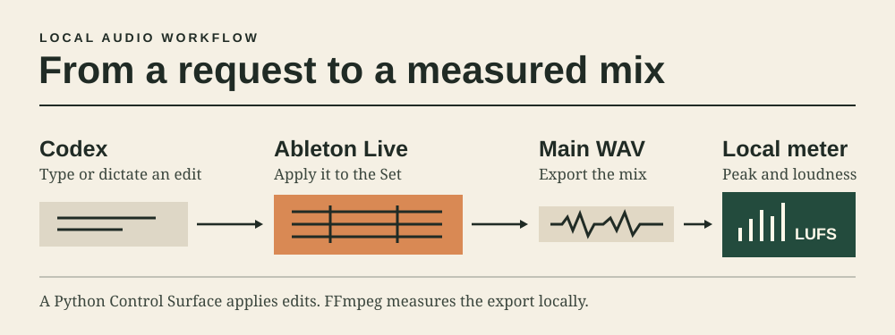

# Codex Ableton Bridge

Control selected Ableton Live operations from typed or dictated Codex requests, then measure the rendered Main output locally.

[Documentation](docs/index.md) · [License](LICENSE)

Codex translates intent into an edit. A Python Control Surface applies it in Live, and an exported Main WAV supplies the signal for measuring peaks and loudness.

This is the repository scaffold. The implementation and reproducible setup are reviewed through the first pull request.
