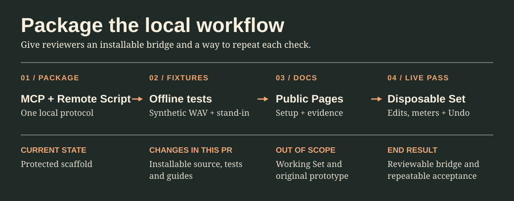

# Package the local workflow

[Documentation](index.md) · [Acceptance procedure](verification.md)

**Starting point.** The protected default branch contains the public scaffold. The working implementation adds an installable MCP package, a separately installed Live script, synthetic verification and public documentation. The earlier Live result belongs to the original prototype.

**Change record.** Codex gains the packaged inspector, selected edits and export meters. The Python package, Control Surface, protocol, tests and documentation carry the changes. Live owns Set state, device writes, save and Undo. The server exchanges short control messages and scans renders outside Live's audio processing. The original prototype, active working Sets, private media and local installations sit outside this repository work.

## Continue the review

1. Start with the implementation pull request and verify its branch head. Read the architecture and exercise the wheel and offline checks. Confirm Pages publishes from protected `main:/docs`.
2. When a disposable macOS Live 12.4 Intro Set is available, follow [packaged Live acceptance](verification.md#packaged-live-acceptance). Record edit readback, placement, meter results and Undo behavior as separate checks.
3. Stop Live testing when the only available Set is in active use, when the edit target is uncertain, or when a write times out and its outcome cannot be inspected. Use synthetic media for public reproductions.
4. Put corrections on a dedicated branch, stage explicit files and submit the checks in a pull request for the owner to merge.

**Evidence required.** Confirm wheel installation, request expiry, the synthetic meter response and the build of public Pages independently of the manual Live run. A listener evaluates the level-matched audio. The owner decides whether the tested workflow is ready to merge.
