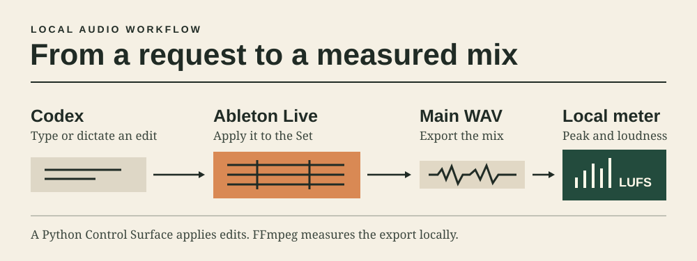

# Codex Ableton Bridge

A local macOS bridge for selected Ableton Live edits and audio measurements.

The development workflow pairs each requested edit with readback from Live and uses a Main export when the result needs an audio measurement.

[Source repository](https://github.com/jeremybboy/codex-ableton-bridge)
